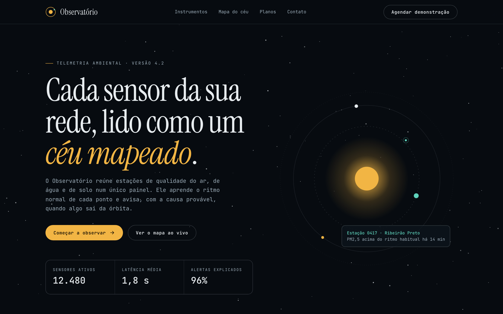
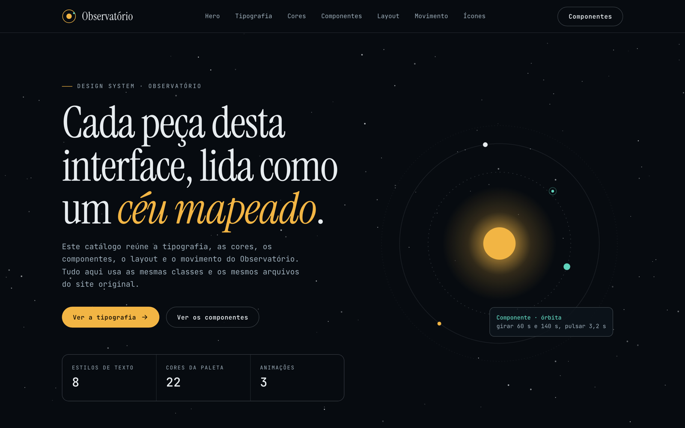
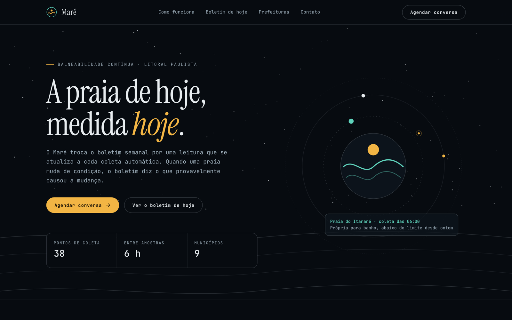
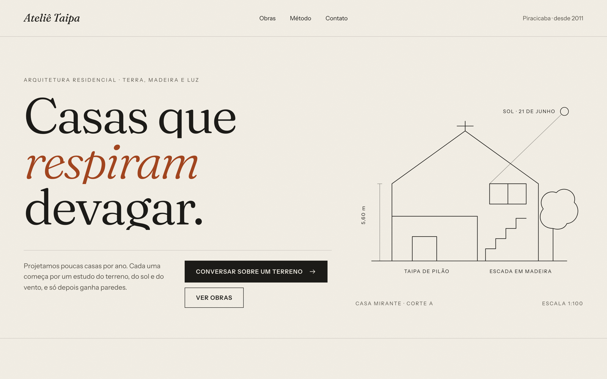
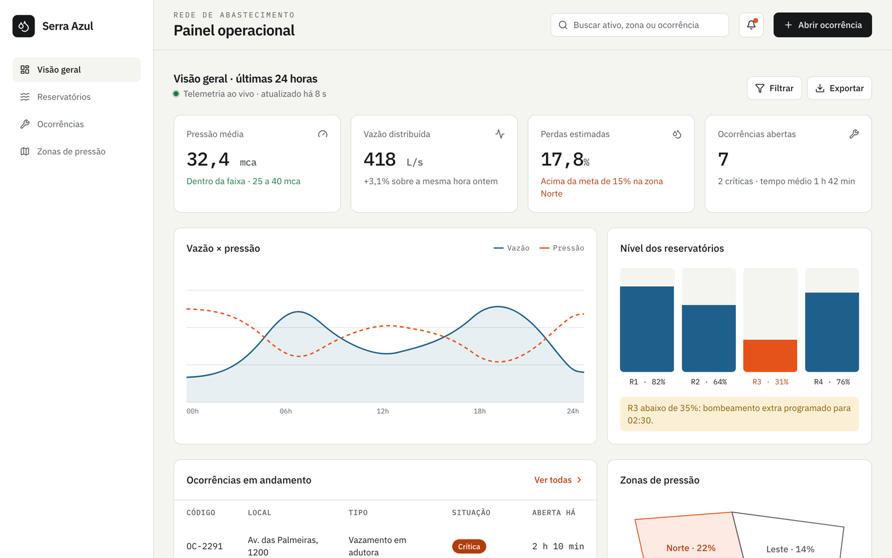
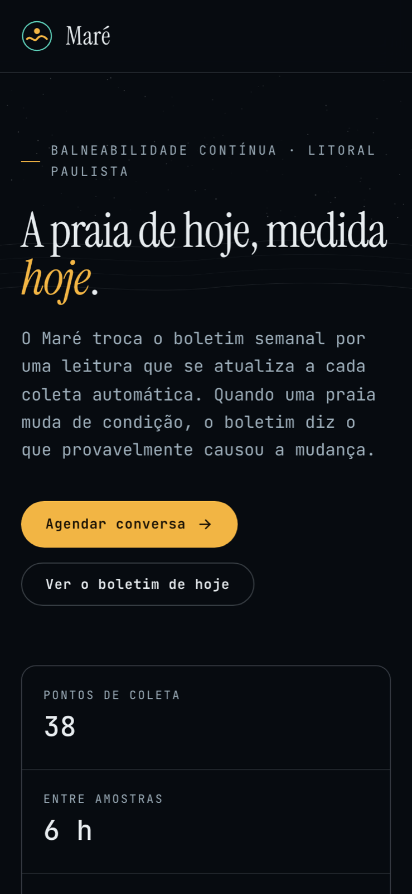

# Vibe Design

**Capture uma referência com fidelidade, extraia o design system dela e construa um site novo, em etapas, com cada passo verificado por script.**

Duas skills do Claude Code, em PT-BR, empacotadas como plugin:

- **`extrair-design-system`**: captura a página (offline, sem injeções) e gera um `design-system.html` navegável, o `STACK.md` e um `manifesto-ds.json` com tudo o que a referência usa.
- **`criar-site`**: constrói um site a partir de um ou dois design systems, uma seção por vez, com aprovação do plano e do hero e verificação de fidelidade, acessibilidade e boas práticas.

| Frame autoral | Design system extraído | Site gerado a partir dele |
|---|---|---|
|  |  |  |

> **In English.** Vibe Design is a Claude Code plugin with two skills. `extrair-design-system` captures a reference web page with full fidelity (offline replay, no injected CSS, no anti-bot evasion) and extracts a verifiable design system: a navigable `design-system.html`, a `STACK.md` and a machine-readable `manifesto-ds.json`. `criar-site` builds a new site from one or two design systems, one section at a time, with human approval checkpoints. Every step is checked by deterministic scripts (capture K1–K5, design system A1–A12, site B1–B13), so results don't depend on model luck. The only dependency is Playwright. Install it with `claude plugin marketplace add <owner>/vibe-design-framework`, then `claude plugin install vibe-design@vibe-design-framework` (see [Instalação](#instalação)). Docs are in Brazilian Portuguese.

## Por que existe

Pedir um site a um modelo de linguagem com uma frase ("uma landing escura com neon") devolve a média da web: paleta batida, seções empilhadas, pouco movimento. Mandar um print ajuda no layout, mas perde fontes, curvas de animação e estados de hover. O que descreve um site com exatidão é o **código-fonte**. Este framework transforma o código de uma referência em um contrato (o design system) e só deixa o site novo usar o que está nesse contrato.

Os princípios estão em [docs/metodologia.md](docs/metodologia.md) e as decisões de projeto em [docs/decisoes.md](docs/decisoes.md).

## Como funciona

```
URL ──► capturar.py ──► referência local (index.html + assets + captura.json)
              │            verificar_captura.py: K1–K5
              ▼
   extrair-design-system ──► design-system.html · STACK.md · manifesto-ds.json
              │            verificar_ds.py: A1–A12
              ▼
        criar-site ──► site (index.html + assets + PLANO.md + DESVIOS.md)
                       verificar_site.py: B1–B13
```

- **Captura em modo fidelidade.** Serve o HTML de origem (o JavaScript roda de novo e as animações se repetem como no original), baixa fontes, CDNs, imagens e dados de WebGL, e reescreve todas as URLs para arquivos locais. Um service worker no `servir.py` responde às URLs montadas em tempo de execução. Nada visual é alterado; logins e desafios anti-bot interrompem a captura, sem contorno. Detalhes em [captura-modo-fidelidade.md](skills/extrair-design-system/references/captura-modo-fidelidade.md).
- **Manifesto como contrato.** O `inventariar.py` lista classes, cores, fontes, keyframes, estados, ícones por categoria e mede a tipografia real (tamanho e entrelinha) no navegador. O design system e o site só podem usar o que está no manifesto. Exceções vão para o `DESVIOS.md`, com motivo.
- **Uma seção por vez.** A skill de criação para depois do plano e depois do hero para aprovação, e revisa cada seção com um checklist anti-amador.

## O que é verificado

| Etapa | Critérios | Exemplos |
|---|---|---|
| Captura | K1–K5 | Funciona com a rede bloqueada; prints em 5 posições diferem ≤ 2% do original; ≥ 95% dos estilos calculados iguais; nenhuma tag ou atributo novo; extensões coerentes. |
| Design system | A1–A12 | Nenhum arquivo original alterado; hero com a mesma árvore de tags e classes; classes, cores, fontes e keyframes ⊆ fonte; rótulo `tamanho / entrelinha` igual ao medido; tudo em PT-BR. |
| Site | B1–B13 | Seções iguais ao plano; classes e cores ⊆ manifestos; sem requisições a terceiros; sem rolagem horizontal em 360/768/1440 px; contraste AA, foco visível, `prefers-reduced-motion`; metadados e headings. |

Resultados registrados em [docs/validacao/](docs/validacao/): os três frames autorais e três páginas públicas reais passam em K1–K5 (pior diferença visual de 0,53%); os design systems do Observatório (frame em PT-BR) e de uma página real em inglês passam em A1–A12; o site Maré passa em B1–B13.

## Instalação

Requisitos: [Claude Code](https://code.claude.com) e Python 3.11+.

1. Adicione o marketplace: `claude plugin marketplace add <owner>/vibe-design-framework`
2. Instale o plugin: `claude plugin install vibe-design@vibe-design-framework`
3. Instale o Playwright: `pip install playwright`
4. Baixe o Chromium: `python3 -m playwright install chromium`
5. Abra o Claude Code numa pasta de trabalho e use as skills (abaixo).

Para desenvolver no próprio repositório: `uv sync`, depois `uv run playwright install chromium` e `uv run python -m unittest discover -s tests`.

## Uso

```text
/vibe-design:extrair-design-system https://exemplo.com.br referencias/exemplo
/vibe-design:criar-site referencias/exemplo sites/meu-projeto
```

As skills também são acionadas por pedidos em linguagem natural, como "extraia o design system desta página" ou "crie uma landing a partir da referência X".

Os scripts funcionam sozinhos:

```text
python3 skills/extrair-design-system/scripts/capturar.py <url> <pasta>
python3 skills/extrair-design-system/scripts/servir.py <pasta>
python3 skills/extrair-design-system/scripts/verificar_captura.py <pasta>
python3 skills/extrair-design-system/scripts/inventariar.py <pasta>
python3 skills/extrair-design-system/scripts/verificar_ds.py <pasta>
python3 skills/criar-site/scripts/verificar_site.py <pasta-do-site>
```

## Exemplos

- [`examples/frames/`](examples/frames/): três páginas autorais, criadas para o projeto, com fontes OFL locais e gráficos em SVG próprio:
  - Observatório (tema escuro);
  - Ateliê Taipa (tema claro, editorial);
  - Painel operacional (dashboard com Tailwind 4 e Lucide locais).
- [`examples/pipeline/observatorio-noturno/`](examples/pipeline/observatorio-noturno/): a captura do frame, o manifesto, o `design-system.html` e o relatório da extração.
- [`examples/pipeline/site-mare/`](examples/pipeline/site-mare/): um site novo ("Maré", balneabilidade de praias) gerado só com o design system do Observatório, com `PLANO.md`, `DESVIOS.md` e `relatorio-verificacao.md`.

| Ateliê (claro) | Painel (dashboard) | Maré no celular |
|---|---|---|
|  |  |  |

## Limitações

- Páginas com login, CAPTCHA ou proteção anti-bot não são capturadas, por decisão de projeto.
- A captura é de uma página por vez. Links para outras páginas continuam apontando para o site original.
- Cenas WebGL e vídeos são capturados quando vêm por requisições comuns; streams (HLS/DASH) e WebSockets não.
- Abrir a captura com duplo clique (`file://`) não funciona: use `servir.py`.
- O conteúdo de sites de terceiros pertence a seus autores. Capture para estudo e mantenha as capturas fora de repositórios públicos (`referencias/` já está no `.gitignore`).

## Licença

Código e documentação sob [MIT](LICENSE). Fontes, ícones e bibliotecas empacotados nos exemplos mantêm suas próprias licenças, listadas em [NOTICE.md](NOTICE.md) e em [THIRD_PARTY_LICENSES/](THIRD_PARTY_LICENSES/).
